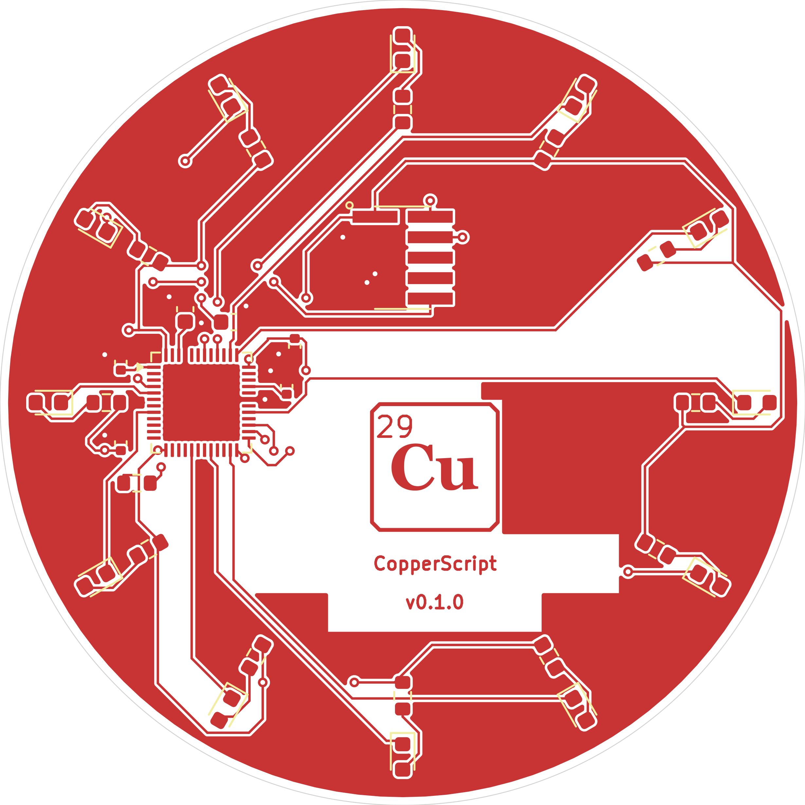
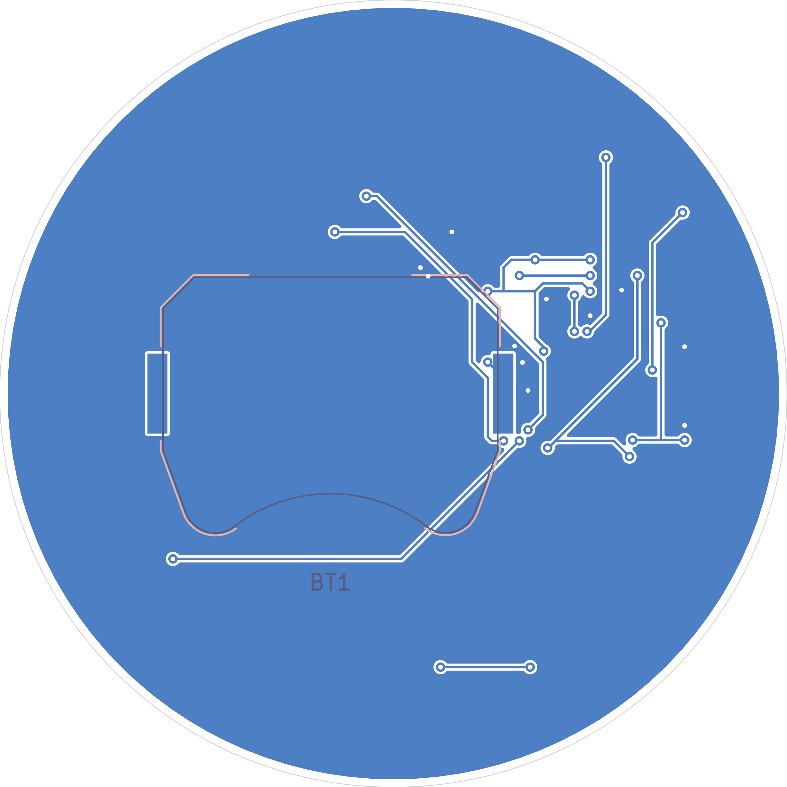

# CopperLedRing

## Migration branch: Rust and standard layout

The active compiler is pinned in [.copper-version](.copper-version) to the
Rust-only CopperScript revision `21b2ca44aee63665feeb67e39da1713ac693e934`.
Run `make install-compiler`, `make fetch`, `make check` and `make compile`.
The same commands support `TARGET=main`; `COPPER` selects an explicit binary.
On Windows use `./build.ps1 -Action check` (GNU Make and Git Bash shortcut).
Later README sections retain historical build/evidence descriptions; use this
section and the migration guide for current commands.
See [migration status and remaining gates](docs/project-migration.md).
Normal source commands require no Python compiler package. Existing Python
tests/generators are retained for porting, not silently counted as passing.
The source CI is a subset, not a routing, packaging or release approval.


LLM agents: start with `copper agent-guide` in the selected CopperScript
environment; see [the project pointer](AGENTS.md) and retain it in new projects.

[](https://github.com/andenore/CopperLedRing/actions/workflows/build.yml)

A minimal [CopperScript](https://github.com/andenore/CopperScript) example and
reusable board-project template: twelve independent red LEDs on a 50 mm circular,
two-layer board, controlled by an nRF52832 QFAA. The rear holds a Keystone 3034
CR2032 holder; a 10-pin SMD Cortex-M header provides SWD. **Bluetooth is not
fitted**: there is no antenna or external crystal.

The front now carries the CopperScript Cu logo, name and compiler version in
**exposed copper**. This branded source is an inspection build. All 31 ordinary
nets route, and KiCad 10.0.6 refill/DRC reports zero violations and zero opens,
but `fabrication_ready=false`: copper glyph geometry, filled-artwork minimum
features and exposed-mask registration/slivers still lack qualification.
Native DRC does not close those checks or approve an order.

CopperScript silkscreen support is pinned to commit
`081ace9ad9af6ba6b0f186195b7ba6efdd69dfa5`; CopperLib is pinned to
`91e6d6cb11273ec9ce26f2181f4a081e6ef7e16a`. The locked `make` targets and CI
build the branded source with these exact revisions. This snapshot routes all
31 ordinary nets and passes native KiCad DRC, while `fabrication_ready=false`:
copper glyph geometry, filled-artwork feature widths and exposed-mask
registration/slivers still lack qualification. Native DRC does not close those
checks or approve an order. Old manufacturing files and release evidence do not
apply to the updated dependency locks.

## Copper branding

The artwork is declared directly in [board.copper](board.copper):

```copper
silkscreen {
    branding {
        position = (27mm, 29mm);
        size = 8mm;
        layout = stacked;
        side = front;
        material = copper;
        exposed = true;
    }
}
```

`position` is the logo centre. The 8 mm logo has compact 0.8 mm name/version
labels below it. `material = copper` selects `F.Cu`; `exposed = true` adds matching
`F.Mask` openings without paste. The artwork is floating and adds no electrical
net, component or BOM item. Shared placement/routing reserves clearance around
it, including clearance from the GND pour. All 34 component poses remain fixed.

The version is captured from the compiler package at build time, rather than
hard-coded into this board. The package version is `v0.1.0`; use the exact Git
revision in [figure provenance](docs/images/branding-build.json) to identify the
compiler source and its native validation results.

To omit the default branding, replace its declaration with
`branding { enabled = false; }`. To print it in ordinary silkscreen instead,
set `material = silkscreen; exposed = false;`. Authored artwork and footprint
silkscreen remain when branding is disabled.

## Routed board

These are exports of the freshly routed and refilled branded KiCad board,
not photographs of assembled hardware. Front copper is red, rear copper is
blue; both sides have GND pours with disconnected islands removed. The front
shows the isolated Cu mark and its labels below the SWD header. The mirrored
rear shows the battery-holder outline and new routes. Fabrication labels are
omitted on the front for readability. Layer colours do not depict solder-mask
colour or the chosen copper finish.

| Front: copper branding, routes, GND fill and silkscreen | Rear: mirrored copper, holder outline and GND fill |
| --- | --- |
|  |  |

Vector figures: [front SVG](docs/images/routed-front.svg),
[rear SVG](docs/images/routed-back.svg).

Snapshot built on 2026-10-12 from `board.copper` SHA-256
`364fb87637711bd899a2606120ba53cd15aee73c4f65df987d593f314698a9ea`. The standard balanced `route-board` pipeline with the updated locks produced 275 tracks
and 39 vias; all 31 ordinary nets routed, and native fill closed the deferred
GND connectivity. The retained report has `routing_complete=true`,
`native_fill_verified=true` and **`fabrication_ready=false`**. Its Physical-IR
DRC coverage remains incomplete for artwork even though native DRC passes.
No hand routing, clearance waiver or via-in-pad permission was used.

Figures are snapshots. Source/placement/compiler changes invalidate the old
routing, fill, manufacturing and image evidence. The source and freshly generated
reports remain authoritative.

## Build and regenerate figures

Install Git, Python 3.12.15, [uv 0.13.0](https://github.com/astral-sh/uv/releases/tag/0.13.0), GNU Make and KiCad 10 with standard
footprint libraries. `uv.lock` pins CopperScript commit
`081ace9ad9af6ba6b0f186195b7ba6efdd69dfa5`; `copper.mod` and `copper.lock`
pin CopperLib commit `91e6d6cb11273ec9ce26f2181f4a081e6ef7e16a`. Run
`uv sync --locked` and `make check` to validate those pins. Generic placement,
routing and validation stay in CopperScript/KiCad; there is no board-specific
repair script or local library replacement. CI uses KiCad 10.0.7; the figures
and native DRC snapshot here were generated with KiCad 10.0.6.

After `uv sync --locked`, run the standard bounded review from this repository:

```sh
make route-review REVIEW_COPPER=".venv/bin/python -m copperscript" REVIEW_DIR=build/branding-review-new
```

`REVIEW_DIR` must be new. This command uses the project’s locked compiler and
UV pins. Review `route.json` and `route.summary.json`, including their
completeness and `fabrication_ready` fields: a routing pass is not
fabrication/assembly signoff.

Windows, using the locked local environment:

```powershell
$env:KICAD_PYTHON = "C:/Program Files/KiCad/10.0/bin/python.exe"
make route-review REVIEW_COPPER=".venv/Scripts/python.exe -m copperscript" REVIEW_DIR=build/branding-review-new KICAD_CLI="C:/Program Files/KiCad/10.0/bin/kicad-cli.exe" FOOTPRINT_ROOT="C:/Program Files/KiCad/10.0/share/kicad/footprints"
```

Refill/save the resulting candidate and check native DRC before exporting the
same README layer combinations (on Windows substitute the executable path):

```sh
kicad-cli pcb drc --refill-zones --save-board --format json --severity-all --exit-code-violations -o build/branding-review-new/drc.json build/branding-review-new/candidate.kicad_pcb
kicad-cli pcb export svg --layers F.Cu,F.Silkscreen,Edge.Cuts --mode-single --fit-page-to-board --exclude-drawing-sheet --check-zones -o build/branding-review-new/readme-front.svg build/branding-review-new/candidate.kicad_pcb
kicad-cli pcb export svg --layers B.Cu,B.Fab,B.Silkscreen,Edge.Cuts --mirror --mode-single --fit-page-to-board --exclude-drawing-sheet --check-zones -o build/branding-review-new/readme-back.svg build/branding-review-new/candidate.kicad_pcb
```

The committed PNGs are 300 dpi rasterizations of these SVGs on white, using
Sharp (version recorded in the provenance). With Node.js and Sharp installed:

```sh
node -e "require('sharp')(process.argv[1], {density:300}).flatten({background:'#ffffff'}).png().toFile(process.argv[2])" build/branding-review-new/readme-front.svg docs/images/routed-front.png
node -e "require('sharp')(process.argv[1], {density:300}).flatten({background:'#ffffff'}).png().toFile(process.argv[2])" build/branding-review-new/readme-back.svg docs/images/routed-back.png
```

Copy the corresponding SVGs to `docs/images/routed-front.svg` and
`docs/images/routed-back.svg`, and update the snapshot hash/provenance with the
new reports. Generated PCB/projects, footprint tables, reports and intermediate
SVGs stay under ignored `build/`. A failed native check is a failed check;
available draft renders are inspection artifacts.

## Pinned build targets

`pyproject.toml` and `uv.lock` pin CopperScript to the published silkscreen
implementation; `copper.mod` and `copper.lock` pin the matching CopperLib
snapshot. CI uses pinned GitHub Actions, Python 3.12.15, uv 0.13.0 and KiCad
10.0.7. The local figure snapshot was checked with KiCad 10.0.6. These build
pins reproduce routing and native DRC, but they do not qualify copper artwork
for fabrication or assembly.

| Target | Purpose |
| --- | --- |
| `make check` | Install locked dependencies, fetch/verify CopperLib and run ERC |
| `make pcb` | Export a placed, unrouted KiCad inspection project |
| `make edit` | Open the shared mechanical/floorplan editor with real footprints |
| `make route` | Run package escapes, routing and native fill verification; profile the run |
| `make route-review` | Run the locked compiler through the standard bounded review |
| `make render` | Export copper SVGs from the existing `build/board.kicad_pcb` |
| `make verify` | Refill/save that board and reject native violations and opens |
| `make assembly` | Validate exact selections and export the JLCPCB BOM |
| `make manufacturing` | Route/verify and export manufacturing files and both-side CPL |
| `make order` | Build and print upload reminders; never submits an order |

The normal pinned build downloads the compiler and library from their committed
GitHub revisions without manual checkouts. The same locked compiler supports the
silkscreen and copper artwork used in this board.

## Mechanical and placement editor

The source includes the circular outline, deliberately fixed front/rear poses,
GND zones and 0.15 mm minimum track/clearance rules. To inspect this source with the locked compiler, run:

```sh
make edit EDITOR_PYTHON=".venv/bin/python"
```

On Windows use `EDITOR_PYTHON=".venv/Scripts/python.exe"` and
add `FOOTPRINT_ROOT="C:/Program Files/KiCad/10.0/share/kicad/footprints"`.
Scroll to zoom under the pointer; right-drag to pan. Toggle Ratsnest to inspect
connectivity. Rough auto-placement is a preview and deliberately fixed poses
stay fixed. Source-lock editing allows a reviewed change to a locked component.

Temporary placement is not saved. Persistent edits show an exact source diff
and require **Save reviewed source**; source Undo/Redo is separate from temporary
placement history. Imported library/profile content is read-only. Source edits
invalidate previous routing/fill/manufacturing evidence. The editor is not an
artwork CAM or assembled-board preview. Ctrl+C stops the server;
`EDITOR_ARGS="--no-browser"` prints its URL.
See the [VS Code extension](https://github.com/andenore/CopperScript/tree/main/integrations/vscode)
for the optional editor host.

## Use this project as a template

Fork/copy the repository, change the module identity in `copper.mod`, then edit
`board.copper` for circuit, outline, artwork and constraints. Keep the AGENTS
pointer and shared build/review workflow. Reusable parts/devices belong in
[CopperLib](https://github.com/andenore/CopperLib) or another URL-imported library.
Use full commit pins and review lock changes when upgrading. Artwork clearance
and qualification need a new review for each board.

## Manufacturing and assembly target

The intended target is assembled, unprogrammed experimental hardware. The
branded source has not reached that target because artwork qualification remains
incomplete; complete the outstanding checks before preparing or tagging an order
build. Old packages are not valid for the branding update. Independent CAM is
explicitly skipped in this example workflow, and firmware remains outside scope.

A future successfully verified build's `build/manufacturing/` contains:

- `gerbers-drill.zip`: copper, mask, silkscreen, paste and circular-outline
  Gerbers with separate plated/nonplated metric drills.
- `bom.csv`: grouped exact JLCPCB selections for 34 components / nine MPNs.
- `cpl.csv`: coordinates/rotations for all 34 parts, including the rear holder.
- `manufacturing-package.zip`: PCB/project, local footprints, IPC-D-356 netlist,
  native positions, DRC report, manifest and checksums.

The [assembly review](ASSEMBLY.md) records exact reusable parts, polarity,
footprint mappings and procurement codes. Check supplier stock, BOM matching,
mask openings over the copper mark, copper finish and assembly preview for the
actual order. Files are not stock reservations, supplier approvals or tested
hardware. The expected board is two-layer, 50 mm circular, 1.6 mm FR-4 with
front/rear assembly; confirm copper weight, finish, stencil/process settings
and double-sided assembly in the quotation. Inspect MCU/SWD pin 1, LED cathodes
and battery polarity/side. Supplier rotation corrections/substitutions are not
guessed. Supply the CR2032 separately.

There is no firmware here. Program over SWD and supply the cell yourself unless
a qualified ordering guide explicitly includes those services. The CR2032 is
**not rechargeable**: SWD VREF is sense-only; never inject debugger power with
the cell installed. Firmware must keep radio, NFC, HFXO and DC/DC disabled as
appropriate and use internal clocks/LDO operation. GPIO LOW illuminates an LED.

## GitHub artifacts

The workflow runs the full pinned `make` build on pushes/PRs/manual runs and
`v*` tags using the compiler/library pins described above. Failed runs retain
diagnostics and available previews as inspection artifacts. Local validation
used KiCad 10.0.6; CI is configured for KiCad 10.0.7.
Manufacturing artifacts and experimental prereleases require the successful
build gates. Do not tag this unqualified artwork update or present earlier
release files as the branded board.

MIT license. Experimental hardware; verify the applicable engineering,
fabrication and assembly evidence before ordering.
